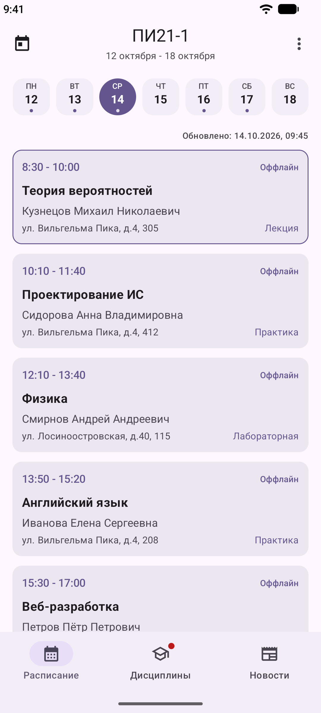
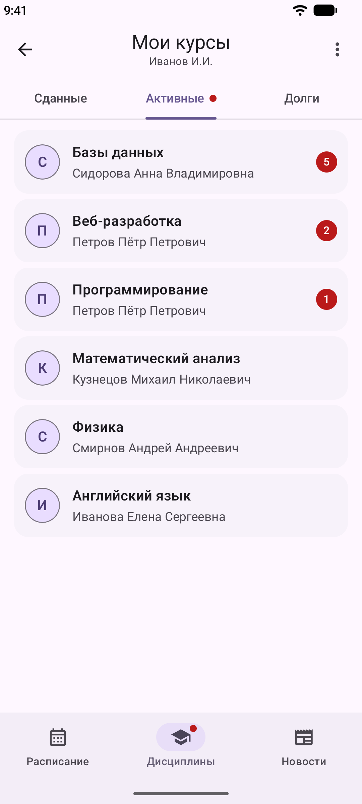
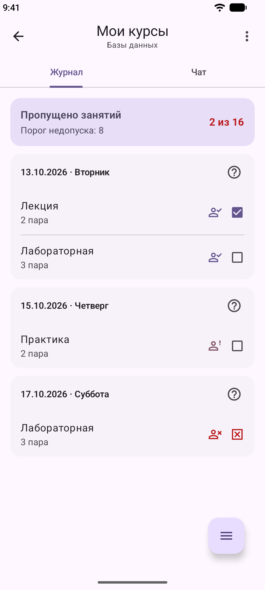
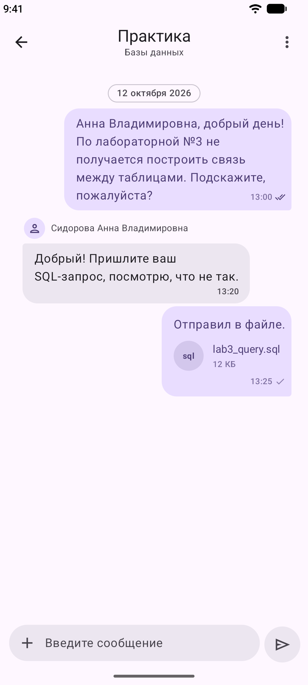
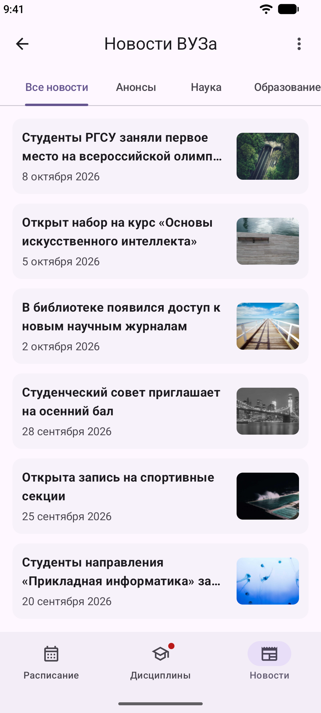
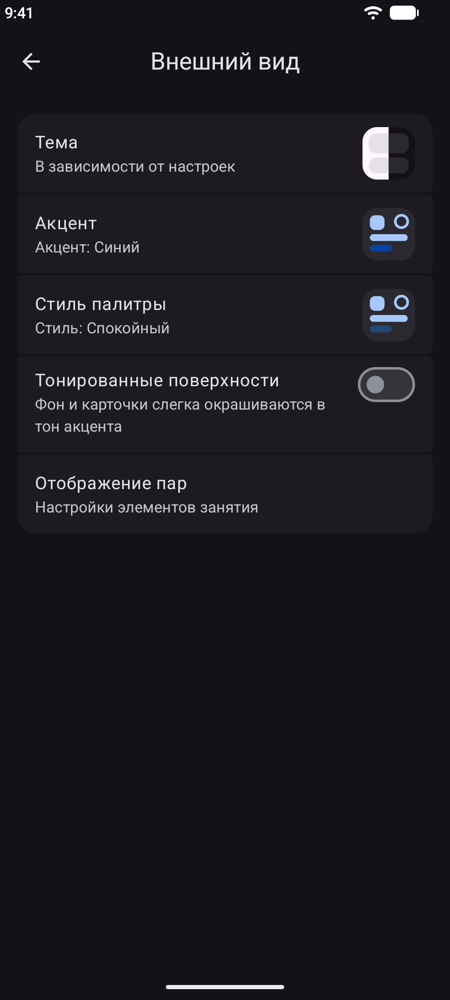

# Мой СтудПортал

**Неофициальный клиент для портала РГСУ**

Расписание · Дисциплины · Журнал · Чаты · Новости

---

## ⚠️ Важно

**Это неофициальное приложение.** Оно **не связано** с администрацией РГСУ, не одобрено и не поддерживается ею.

- Приложение использует **открытые веб-API** портала `my.rgsu.net` и работает так же, как браузер.
- Логин и пароль **не хранятся**. Сессия поддерживается через cookie, зашифрованные в Android Keystore.
- Автор не получает прибыли от проекта. Реклама, донаты и внутриигровые покупки отсутствуют.
- Все данные передаются **напрямую** на официальные серверы РГСУ.

Если вы представляете администрацию вуза и у вас есть вопросы — свяжитесь со мной через [Telegram](https://t.me/mr_red_foxxx).

---

## ✨ Возможности

### 📅 Расписание
- Просмотр расписания по группам и преподавателям
- Свайпы между днями и неделями
- Календарь с точками на днях, где есть пары
- Автоматическое определение текущей пары
- Разные фразы для выходных

### 🎓 Дисциплины
- Три вкладки: **Активные**, **Сданные**, **Долги**
- Журнал посещаемости и заданий
- Непрочитанные сообщения прямо на карточке курса
- Закрепление важных предметов
- Фото преподавателей

### 💬 Чаты
- Встроенный чат по каждой дисциплине
- Отправка файлов (до 25 МБ) и фото
- Индикатор набора и статус прочтения
- Уведомления о новых сообщениях (с тихими часами)
- Скачивание файлов в Downloads

### 📰 Новости
- 8 рубрик, включая «Личности РГСУ» и «РГСУ в СМИ»
- Бесконечная прокрутка
- Чтение внутри приложения

### 🎨 Оформление
- Material 3 Expressive
- Динамические цвета (Android 12+)
- 10 акцентов и 5 стилей палитры
- Тёмная и AMOLED-тема

---

### 🧩 Виджеты
- **Следующая пара** — что идёт сейчас или будет дальше
- **Расписание на сегодня** — все пары текущего дня

## 📱 Скриншоты

| Расписание | Дисциплины | Журнал |
|:---:|:---:|:---:|
|  |  |  |

| Чат | Новости | Внешний вид |
|:---:|:---:|:---:|
|  |  |  |

---

## 📥 Установка

### Через GitHub Releases

1. Перейдите в раздел [**Releases**](../../releases/latest).
2. Скачайте `.apk`-файл последней версии.
3. Разрешите установку из неизвестных источников, если Android попросит.
4. Установите APK.

### Требования

- Android **8.0** (API 26) или новее
- Активная учётная запись РГСУ

---

## 🛠 Технологии

| Слой | Стек |
|---|---|
| **Язык** | Kotlin 2.4 |
| **UI** | Jetpack Compose, Material 3 Expressive |
| **Архитектура** | MVVM, StateFlow |
| **Сеть** | OkHttp, Retrofit, Socket.IO |
| **Парсинг** | Jsoup |
| **Хранение** | Room, EncryptedSharedPreferences, DataStore |
| **Фон** | WorkManager, Glance (виджеты) |
| **Картинки** | Coil |
| **Тема** | [MaterialKolor](https://github.com/jordond/materialkolor) |
| **Календарь** | [Kizitonwose Calendar](https://github.com/kizitonwose/calendar) |

---

## 🔐 Приватность

- Логин и пароль **не сохраняются** на устройстве.
- Сессионные cookie зашифрованы через `EncryptedSharedPreferences` (ключ в Android Keystore).
- Приложение **не имеет** собственного бэкенда — все данные идут напрямую в РГСУ.
- Приложение **не собирает** аналитику, не показывает рекламу и не передаёт данные третьим лицам.

---

## 🐛 Сообщить о баге

Нашли проблему? [Создайте Issue](../../issues/new) с описанием:

- Что делали
- Что ожидали
- Что произошло
- Версия Android и модель устройства

---

## 🗺 Планы

- [ ] Поддержка планшетов и складных устройств
- [ ] Компаньон для Wear OS

---

## 📄 Права

**All rights reserved.** © 2026 MrRedFoxxx

Исходный код не публикуется. Повторное использование, распространение или модификация без письменного разрешения автора не допускаются.

---

Сделано с ❤️ студентом для студентов

**[Telegram](https://t.me/mr_red_foxxx)** · **[GitHub](https://github.com/MrRedFoxxx)**

